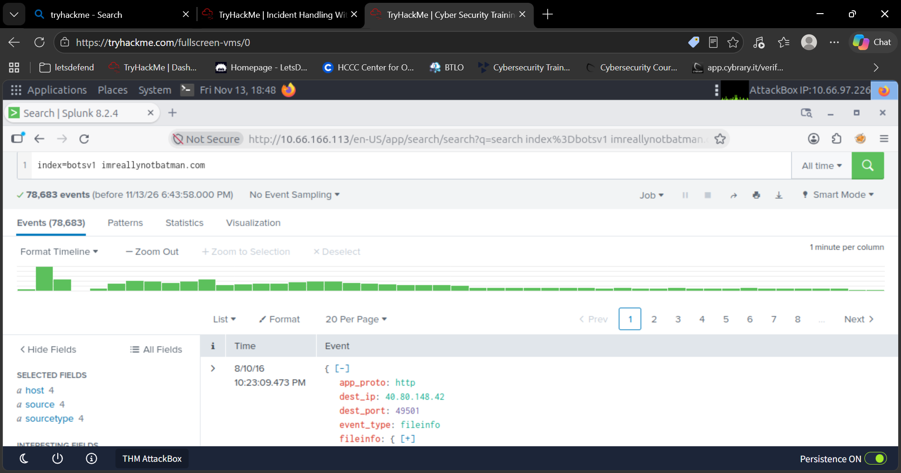
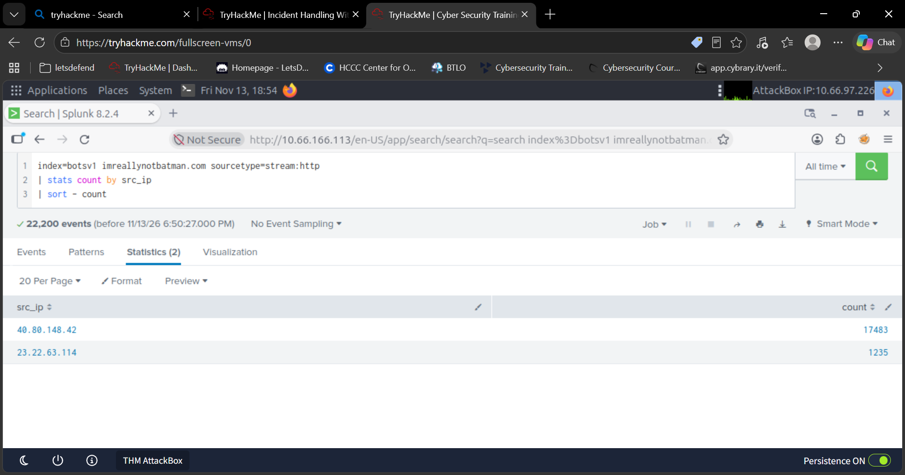
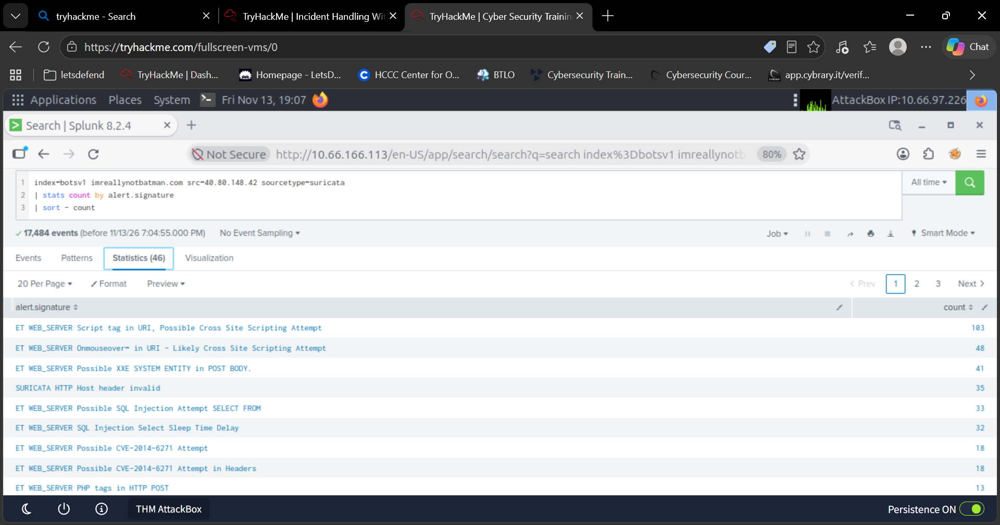
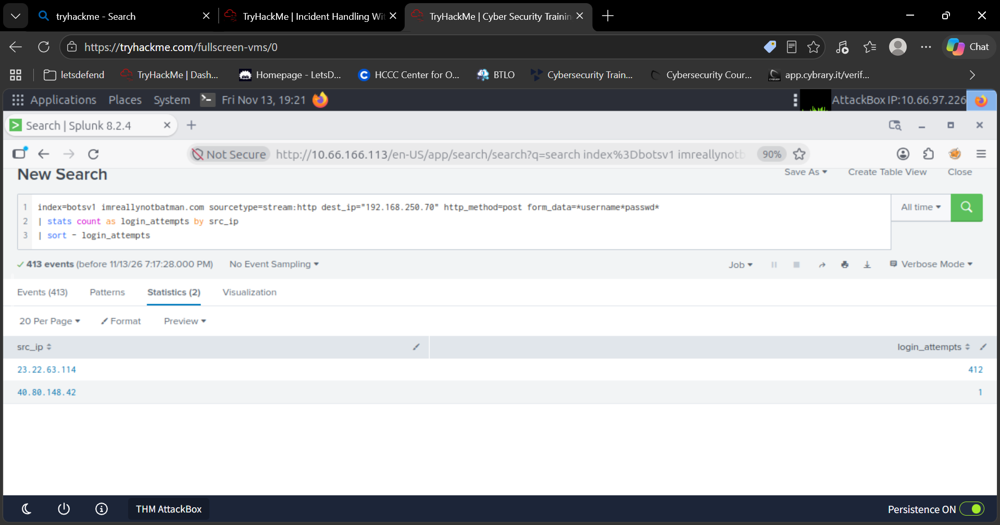
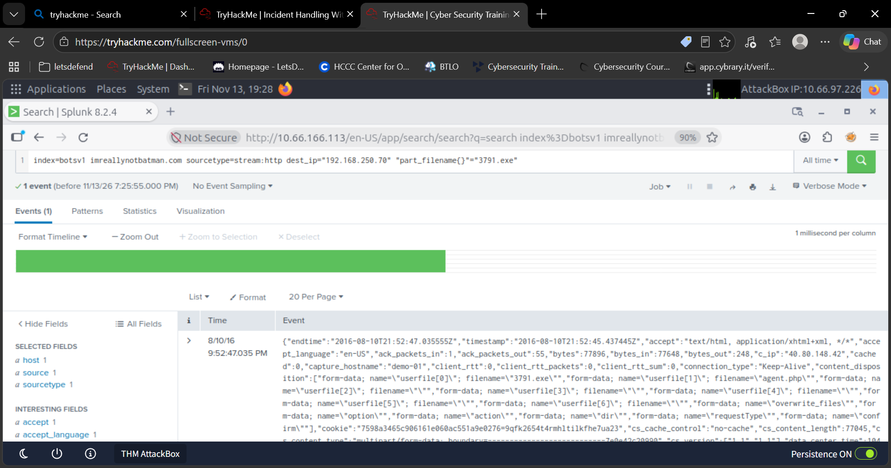
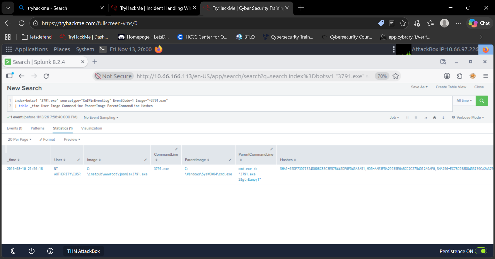
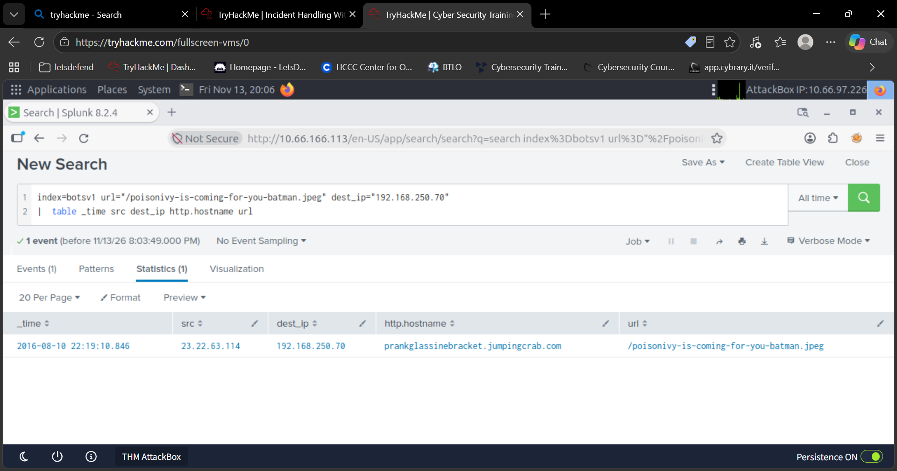

# SOC Incident Investigation – Splunk

## Project Overview

This project documents a hands-on Security Operations Center (SOC) investigation using Splunk to analyze a simulated cyberattack against a web server.

The investigation uses the Boss of the SOC (BOTS) dataset and focuses on identifying suspicious network activity, analyzing web traffic, investigating authentication attempts, detecting potential exploitation, and examining suspicious file uploads and process execution.

The objective is to demonstrate practical SOC analyst skills through log analysis, threat detection, event correlation, and incident investigation.

## Investigation Objectives

- Identify suspicious source IP addresses and network connections.
- Investigate HTTP requests targeting a web server.
- Analyze authentication attempts and potential brute-force activity.
- Examine Suricata security alerts.
- Investigate suspicious file uploads.
- Correlate Sysmon process creation events.
- Identify indicators associated with potential web server compromise.
- Document findings using evidence from Splunk.

## Tools and Technologies

| Tool | Purpose |
|---|---|
| Splunk 8.2.4 | SIEM and log analysis |
| Sysmon | Windows process monitoring |
| Suricata | Network threat detection |
| HTTP Stream | Web traffic investigation |
| FortiGate UTM | Firewall and security event analysis |
| TryHackMe | Cybersecurity training environment |
| SPL | Search Processing Language |

## Investigation Environment

- SIEM: Splunk
- Dataset: Boss of the SOC (BOTS) v1
- Index: `botsv1`
- Target server IP: `192.168.250.70`
- Suspicious domain: `imreallynotbatman.com`

## Investigation Workflow and Findings

### 1. Reconnaissance – Domain Discovery

Identified the suspicious domain `imreallynotbatman.com` within HTTP traffic logs.

Investigated network connections and identified relevant source IP addresses communicating with the target server.

**Key observations:**
- Suspicious domain activity.
- HTTP communication with the target server.
- Identification of relevant source IP addresses.

### 2. Source IP Analysis

Analyzed network traffic to identify the IP addresses associated with suspicious activity.

**Identified IP addresses:**
- `40.80.148.42`
- `23.22.63.114`

These addresses were used as investigation pivots to correlate network and application events.

### 3. Suricata Alert Investigation

Analyzed Suricata alerts associated with the suspicious domain.

Identified multiple security signatures indicating potential web application attacks.

**Observed alert categories:**
- Cross-Site Scripting (XSS)
- SQL Injection
- XML External Entity (XXE)
- Invalid HTTP Host Header

### 4. Authentication and Brute-Force Analysis

Investigated HTTP POST requests targeting the Joomla administrator login page.

The analysis identified:
- 413 authentication-related events.
- 412 unique password values.
- Two source IP addresses associated with the observed attempts.

The results indicate suspicious authentication activity requiring further investigation.

### 5. Suspicious File Upload Investigation

Investigated HTTP traffic associated with file uploads to the web server.

Identified two filenames in the upload activity:
- `3791.exe`
- `agent.php`

The corresponding event contained an upload success message.

This finding indicated potentially malicious file placement on the web server.

### 6. Sysmon Process Creation Analysis

Used Windows Sysmon Event ID 1 (Process Creation) to investigate the execution of `3791.exe`.

**Observed process information:**
- Executable: `3791.exe`
- Location: `C:\inetpub\wwwroot\joomla\3791.exe`
- Parent process: `cmd.exe`
- Execution context: `NT AUTHORITY\IUSR`

This evidence connects the suspicious executable to process execution on the investigated server.

### 7. Actions on Objectives – Suspicious Web Artifact

Investigated HTTP requests associated with the suspicious image filename:

`poisonivy-is-coming-for-you-batman.jpeg`

The request was associated with the suspicious domain:

`prankglassinebracket.jumpingcrab.com`

This artifact was investigated as a possible indicator of attacker messaging or website defacement activity.

Further validation is required before confirming the full impact.

## Technical Skills Demonstrated

- SIEM investigation using Splunk.
- SPL query development.
- Network traffic analysis.
- Source IP investigation.
- HTTP log analysis.
- Brute-force detection.
- Suricata alert analysis.
- Windows event log investigation.
- Sysmon Event ID 1 analysis.
- Suspicious file upload investigation.
- Process execution analysis.
- Security incident documentation.

## Conclusion

This investigation demonstrates a practical approach to identifying and analyzing suspicious activity within a simulated enterprise environment.

By correlating HTTP traffic, authentication events, Suricata alerts, firewall logs, and Sysmon process creation events, I developed a better understanding of how SOC analysts investigate potential security incidents.

This project strengthened my practical skills in SIEM operations, threat detection, log correlation, and incident investigation.

## Disclaimer

This project was completed in an authorized TryHackMe training environment using simulated security data.

All findings are intended for educational and defensive cybersecurity purposes.

---

**Author:** Cybersecurity Student | Aspiring SOC Analyst  
**Platform:** TryHackMe  
**Focus:** Blue Team | SOC Operations | SIEM Investigation
